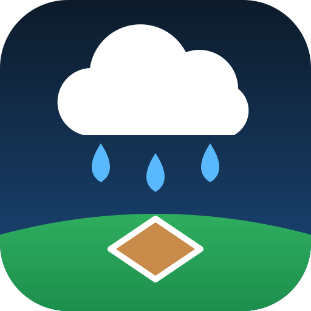

<p align="center"></p>

# Rain-Outsource

**Will the weather wreck it? Free odds that your game, race or outdoor plan happens, with the reason and the source. For AI agents and people. No key needed.**

**Mission:** to be the default service for ALL AI agents and ALL humans, worldwide, for checking any prediction that depends on weather.

[Website](https://rainout-agent-source.vercel.app/) · [MCP endpoint](https://rainout-agent-source.vercel.app/mcp) · [llms.txt](https://rainout-agent-source.vercel.app/llms.txt) · [OpenAPI](https://rainout-agent-source.vercel.app/openapi.yaml) · [Docs](https://bizwaxx.github.io/Rain-Outsource/) · [Privacy](https://rainout-agent-source.vercel.app/privacy) · [Terms](https://rainout-agent-source.vercel.app/terms)

## What it does

Ask a plain question, like "Is my softball game tonight still on?", "Will the motocross race happen Saturday?" or "Will it rain in Tokyo at 3 PM?" You get back a percent, one sentence saying why, and where the answer came from.

- It checks the official league, venue or track status first. Official status always wins.
- With no official word, it uses the forecast (NWS in the US, Open-Meteo elsewhere) and ten years of NOAA rain history at the nearest station. For dirt motocross tracks it also counts the rain from the day or two before.
- It never makes up an official status. If the league hasn't said, it tells you so and gives the rainout line or page.

## When should an agent call it?

Whenever a user's plan depends on the weather: "is the game on?", "will the race happen?", "which games on our schedule might get rained out?", "will it rain there at that time?" Every tool is read-only except `report_cancellation`, which shares an anonymous rainout report, and only after the user agrees. It never writes to calendars. It returns a ready-made Google Calendar event and ICS text, and your agent asks the user before adding them.

## Quick start (free, no key, no signup)

```bash
# Rain chance anywhere in the world
curl "https://rainout-agent-source.vercel.app/v1/rain?q=London&hours=6"

# Find a field, then get the play odds for a game time
curl "https://rainout-agent-source.vercel.app/v1/fields?q=Zilker&state=TX"
curl "https://rainout-agent-source.vercel.app/v1/status?field_id=Krieg&game_time=2026-10-23T20:20:00-05:00"
```

**Claude Code**

```bash
claude mcp add --transport http rain-outsource https://rainout-agent-source.vercel.app/mcp
```

**Claude (desktop and web):** Settings → Connectors → Add custom connector → `https://rainout-agent-source.vercel.app/mcp`

**Cursor, VS Code and other MCP clients** (`mcp.json`):

```json
{ "mcpServers": { "rain-outsource": { "url": "https://rainout-agent-source.vercel.app/mcp" } } }
```

**ChatGPT:** turn on developer mode under Settings → Apps and Connectors (plans that allow custom connectors), then create a connector with the MCP URL above and no authentication. For a custom GPT, import [`openapi.yaml`](https://rainout-agent-source.vercel.app/openapi.yaml) as an Action.

## Tools (MCP, Streamable HTTP, no auth)

| Tool | What it answers | Returns |
|---|---|---|
| `find_team` | Which team is the user on? | Candidates with `team_id` and confidence |
| `get_games` | A team's games and the odds for each | `play_probability`, `reason`, `calendar_event`, `ics` |
| `check_game` | Is my game on? | One game with odds, reason and official status |
| `get_venue_status` | Odds at a field for a time | Official status, rain chance, play odds, rainout line |
| `find_venue` | Find a field anywhere in the US | `field_id`, `verification_level` (`confirmed` or `osm_only`) |
| `check_schedule` | Which games on this schedule are at risk? | Per-game odds and risk flags (ICS, CSV or JSON in) |
| `find_track` | Find a motocross track | `track_id`, confidence, verification level |
| `get_track_events` | Upcoming races and their odds | Events with odds, official status and sources |
| `check_race` | Will the race happen? | One-sentence `answer` plus the event |
| `get_track_history` | How often does it rain out there? | Monthly NOAA rain stats and documented rainouts |
| `get_rain_chance` | Will it rain at this place and time? | Hourly or daily rain chance and amounts, `summary` |
| `report_cancellation` | "We got rained out" | Stores an anonymous report for 24 hours |

Every answer includes a plain sentence to read aloud (`reason`, `answer` or `summary`) and names its sources. Discovery files: [`/llms.txt`](https://rainout-agent-source.vercel.app/llms.txt), [`/openapi.yaml`](https://rainout-agent-source.vercel.app/openapi.yaml), [`/.well-known/mcp/server-card.json`](https://rainout-agent-source.vercel.app/.well-known/mcp/server-card.json), [`server.json`](server.json) (Official MCP Registry).

## Coverage today, and limits

- **Fields:** about 64,000 US softball, baseball and soccer fields, plus 162 US motocross tracks, from OpenStreetMap (`osm_only`: map data, weather-based odds, no official status source).
- **Hand-checked:** 78 venues and tracks in Texas, Oklahoma, Louisiana and Florida are checked against official rainout pages and phone lines (`confirmed`).
- **Leagues:** City of Austin adult softball and Austin Metro Baseball League schedules, or any schedule link a user provides.
- **Rain chance:** worldwide.
- **Not yet:** venue odds outside the US. Worldwide venues are the goal and are on the way.
- **Limits:** odds are estimates, not promises. This isn't safety, engineering or emergency advice (lightning, flooding, severe weather), and it isn't an official NWS product. Fair-use rate limits apply. Reports are anonymous and unverified.

## Free tier promise

The public API and MCP server are free, with no key and no signup, and that free tier is staying. If paid plans come later, they'll add extras on top. They won't take away what's free today.

## Data sources and licences

US forecasts: National Weather Service API. Rain history: NOAA NCEI. Worldwide forecasts, fallback and place search: [Open-Meteo.com](https://open-meteo.com/) (CC BY 4.0). Venue data © [OpenStreetMap contributors](https://www.openstreetmap.org/copyright) (ODbL). Code: MIT. Questions or problems: [open an issue](https://github.com/bizwaxx/Rain-Outsource/issues).

---

# Reference for developers

**Creator:** JEEZ Labs

## Backend status

Live backend: `https://rainout-agent-source.vercel.app` (Vercel, Python). The same app runs locally (see "Run the backend locally" below). `GET /` returns the JSON service index to agents and API clients, and an HTML landing page to browsers (`?format=json` forces JSON).

Current backend status:

1. Supports `/health` locally and on Vercel-style hosting.
2. Supports `/v1/fields` on live Vercel hosting so agents can discover supported fields, ownership type, aliases, status URLs, and official sources, filterable with `?sport=` and `?state=`.
3. Supports `/v1/status?field_id=Krieg&game_time=...`, `/v1/status?field_id=Craig&game_time=...`, `/v1/status?field_id=Havins&game_time=...`, plus the Austin metro public/private expansion fields locally and on live Vercel hosting.
4. Supports `/api/status?field_id=Krieg&game_time=...` on Vercel-style hosting.
5. Resolves aliases like `Krieg`, `Craig`, `Havins`, `Northeast Metro`, `Southeast Metro`, `Oak Hill Youth Sports`, `Manchaca Optimist`, `T&C Sports`, `Balcones`, `NWLL`, `Western Hills`, `Old Settlers Baseball`, `OSP Softball`, `Brushy Creek Softball`, `Milburn Park`, `Downs Field`, `Anderson High School`, `Georgetown Fields`, `Field of Dreams`, `DSYSA Baseball`, and full field IDs.
6. Pulls live game-time weather from the National Weather Service API, cached (gridpoints 7 days, forecasts 10 minutes), with a free Open-Meteo fallback when NWS is down. Every answer names its weather source.
7. Checks each field's official source page on each status request (Rainout Line and RainedOut pages, SportsConnect field-status widgets, city parks and league field lists, AMBL rainout codes, explicit cancellation notices), but stays conservative: unless the page clearly shows a current status for that venue, official status remains `unknown`, `official_status_check` says why (blocked, unparseable, stale, no match, ...) and the spoken answer tells the user to call the rainout line or check the official source before leaving. Details: `docs/official-status.md`.
8. Calibrates play probability with 10 years of NOAA daily rain history for each field and returns the station used in `historical_calibration`.
9. Checks whole schedules (ICS URL/upload, JSON or CSV) at `/v1/schedule/check` and flags at-risk games.
10. Accepts community cancellation reports at `POST /v1/reports` (and the MCP tool `report_cancellation`); recent reports adjust the odds while the official status is unknown. Details: `docs/reports.md`.
11. Returns `answer_requirements` so outside agents must include field name, official status, rain chance, play probability, and rainout phone or official source in their answer.

## Pilot fields

- Field: Krieg Field Softball Complex
- Address: 515 South Pleasant Valley Road, Austin, TX 78741
- Rainout phone: 512-978-2680
- Weather source: National Weather Service API

- Field: Havins Softball Complex
- Address: 12138 N Lamar Blvd, Austin, TX 78753
- Rainout phone: 512-978-2680
- Official source page: https://www.austintexas.gov/department/athletics
- Weather source: National Weather Service API

- Field: Northeast Metropolitan Park
- Ownership: public
- Address: 2703 Pecan Street, Pflugerville, TX 78660
- Official source page: https://parks.traviscountytx.gov/parks/northeast-metro

- Field: Southeast Metropolitan Park
- Ownership: public
- Address: 4511 Highway 71 East, Del Valle, TX 78617
- Official source page: https://parks.traviscountytx.gov/parks/southeast-metro

- Field: Oak Hill Youth Sports Association
- Ownership: private nonprofit
- Address: 6300 Joe Tanner Lane, Austin, TX 78749
- Official source page: https://www.ohysa.com/

- Field: Manchaca Optimist Youth Sports Complex
- Ownership: private nonprofit
- Address: West FM 1626, Manchaca, TX 78652
- Official source page: https://www.facebook.com/ManchacaOptimist/

- Field: Town & Country Sports Complex
- Ownership: private nonprofit
- Address: 9100 Meadowheath Drive, Austin, TX 78729
- Official field status page: https://www.tandcsports.org/field-status/

- Field: Balcones Youth Sports
- Ownership: private nonprofit
- Address: 3106 Adelphi Lane, Austin, TX 78727
- Official field status page: https://www.balconesyouthsports.org/

- Field: Northwest Little League
- Ownership: private nonprofit
- Address: 3105 Hunt Trail, Austin, TX 78757
- Official field status page: https://www.nwll-austin.org/

- Field: Western Hills Little League
- Ownership: private nonprofit
- Address: Austin, TX
- Official source page: https://www.westernhillslittleleague.com/

- Field: Old Settlers Baseball Complex
- Ownership: public
- Address: 3300 E Palm Valley Blvd, Round Rock, TX 78665
- Official source page: https://www.roundrocktexas.gov/city-departments/parks-and-recreation/old-settlers-baseball/
- Parks phone: 512-218-5540

- Field: Old Settlers Hall of Fame Softball Complex
- Ownership: public
- Address: 3300 E Palm Valley Blvd, Round Rock, TX 78665
- Official source page: https://www.roundrocktexas.gov/city-departments/parks-and-recreation/old-settlers-softball/
- Parks phone: 512-218-5540

- Field: Brushy Creek Sports Park Softball Fields
- Ownership: public
- Address: 2310 Brushy Creek Road, Cedar Park, TX 78613
- Official field status page: https://www.cedarparktexas.gov/947/Athletic-Facilities

- Field: Elizabeth Milburn Park Multipurpose Fields
- Ownership: public
- Address: 1901 Sun Chase Blvd, Cedar Park, TX 78613
- Official field status page: https://www.cedarparktexas.gov/947/Athletic-Facilities

- Field: Downs Field
- Ownership: public / league-used
- Address: 2816 E. 12th Street, Austin, TX 78702
- Official league field page: https://www.austinmetrobaseball.com/fields.php

- Field: Anderson High School Baseball Field
- Ownership: school / league-used
- Address: 8403 Mesa Drive, Austin, TX 78759
- Official league field page: https://www.austinmetrobaseball.com/fields.php

- Field: San Gabriel Park - GYBA Field 8
- Ownership: public / league-used
- Address: E. Morrow Street & N. College Street, Georgetown, TX 78626
- Official league field page: https://www.austinmetrobaseball.com/fields.php

- Field: CTX Field of Dreams
- Ownership: private / league-used
- Address: 7398 Creek Rd, Dripping Springs, TX 78620
- Official directory page: https://www.atxyouthbaseball.com/directory-resources/ctx-field-of-dreams

- Field: DSYSA Baseball & Softball Sports Complex
- Ownership: private nonprofit
- Address: 520 Sportsplex Drive, Dripping Springs, TX 78620
- Official DSYSA status/protocol page: https://www.dsysasports.org/fields

- Field: DSYSA Sports Park Fields
- Ownership: private nonprofit
- Address: 370 Sports Park Rd, Dripping Springs, TX 78620
- Official DSYSA status/protocol page: https://www.dsysasports.org/fields

## Agent rule

Official rainout status wins. Weather gives drive risk and game-time play probability. If the official source is checked but unclear, keep status as `unknown` instead of guessing.

Play probability with an `unknown` status starts at 96% (most games are played; the
rest covers normal no-shows and venue issues) and drops with rain chance and storms.
A dry forecast is about 96%, 70% rain is about 40–55%, and storms are at most 50%.
Cancelled is 0%, and delayed or conflicting signals are at most 50%. Each answer
includes a plain-language `reason`. Details: `docs/play-probability.md`.

Use the word **rain**, not **rainfall**, in Dad-facing answers.

## Example answer

Official status is on. At game time, rain chance is 67% with storms likely. Estimated play probability is 25%. Check the rainout line again right before leaving.

## Schedule check (ICS / league schedules)

Check a whole schedule at once and flag games likely to be rained out:

```text
GET  https://rainout-agent-source.vercel.app/v1/schedule/check?ics_url=https://example.org/team.ics
POST https://rainout-agent-source.vercel.app/v1/schedule/check   (JSON games, raw .ics, or CSV)
```

Each game is matched to a venue, scored with the NWS forecast plus NOAA history (or a
history-only outlook beyond ~7 days) and flagged when at risk. Add `format=ics` to get
the calendar back with risk notes in each event. Repeating events (`RRULE`, `EXDATE`,
`RECURRENCE-ID`) are expanded into one game per occurrence in the window. Stateless, SSRF-protected URL fetching,
size/time limits for Vercel. Details: `docs/schedule.md`.

## Teams (for AI agents)

Agents can find a user's team and their games:

```text
GET /v1/teams/search?q=ATX+Boys&venue=Craig+Fields&day=friday
GET /v1/teams/tsl-340-744621-4306365/games?date=today
GET /v1/teams/tsl-340-744621-4306365/calendar.ics
```

Each game includes play odds, a one-sentence spoken `reason`, a Google Calendar API
`calendar_event` with a stable `iCalUID`, and ICS text. Rainout Source never writes to
calendars, so agents must ask the user first. League sources: City of Austin adult softball
(TeamSideline), Austin Metro Baseball League, or any schedule link the user provides (ICS, linked
ICS, JSON-LD or HTML table, with an optional LLM extractor). Details: `docs/teams.md`.
Example conversation: `docs/agent-conversation.md`.

### MCP server and llms.txt

- MCP (Streamable HTTP): `https://rainout-agent-source.vercel.app/mcp`. Tools: `find_team`, `get_games`, `check_game`, `get_venue_status`, `check_schedule`, `find_venue`, `find_track`, `get_track_events`, `check_race`, `get_track_history`, `get_rain_chance`, `get_precipitation_nowcast`, and `report_cancellation` (the only one that stores anything: an anonymous report in the cache). See [docs/mcp.md](docs/mcp.md).
- Agent summary: [`/llms.txt`](https://rainout-agent-source.vercel.app/llms.txt).

## Motocross race checker

For the 10 motocross tracks (Freestone, Swan MX, Murphy's MX, 3 Palms, Cycle Ranch, Dade City,
Orlando MX Park, Mesa, OMC, Sweet 16), agents can ask whether a race will happen:

```text
GET /v1/tracks?q=swan
GET /v1/tracks/swan/events?include_practice=false
GET /v1/tracks/swan/check?date=saturday
GET /v1/tracks/freestone/history
GET /v1/tracks/swan/calendar.ics
```

Events come only from public track and series calendars (track sites, MX Parks, AMA Texas
State Championship series, Florida Motocross Series), never invented; a user-supplied
`events_url` is the fallback. Odds combine official cancel/postpone notices, the race-window
forecast, the prior 24-72h of rain weighted by soil (soaked dirt cancels races) and NOAA history.
History lists monthly rain stats and documented past rainouts with sources and coverage gaps.
Details: [docs/motocross.md](docs/motocross.md).

## Nationwide venues (OpenStreetMap)

Beyond the hand-verified venues, Rainout Source knows tens of thousands of ball fields, soccer complexes and
motocross tracks across the US, built from OpenStreetMap by a reproducible pipeline
(`scripts/osm_venues.py`). They are labeled `verification_level: "osm_only"`: the name and location are
community map data and there's no official status source, so answers use the forecast and the nearest NOAA
station's 10-year monthly rain stats. Hand-verified venues stay `confirmed` and always win over OSM duplicates.

```text
GET /v1/fields?q=Zilker&state=TX
GET /v1/fields?near=30.27,-97.74&radius_km=10&sport=soccer
GET /v1/status?field_id=osm-tx-...&game_time=2026-10-20T19:00:00-05:00
GET /v1/tracks?state=CA           # confirmed + OSM motocross tracks
```

Map data (c) OpenStreetMap contributors, ODbL 1.0. Storage design, pipeline and caveats:
[docs/venues-osm.md](docs/venues-osm.md).

## Rain chance anywhere

`GET /v1/rain?q=London&hours=12` (or `lat=&lon=`, `days=`, `at=`) gives the hourly or daily chance of rain and the
amount for any place in the world, with a one-sentence `summary`. It uses NWS in the US and Open-Meteo
elsewhere and as the fallback, all free with no key. The same module powers the MCP tool `get_rain_chance`, a box CLI
(`rain "Austin, TX"`), the motocross checker and the venue checks. Details: [docs/rain.md](docs/rain.md).

## Rain in the next 2 hours (nowcast, v2 beta)

`GET /v1/nowcast?lat=30.27&lon=-97.74` (or `q=Austin, TX`) gives precipitation for the next 2 hours in 15-minute
steps: amount, intensity, rain chance, when rain starts and stops, and in the US what the nearest NWS station
measured in the last hour. Free sources only: Open-Meteo `minutely_15` (NOAA HRRR over North America) and NWS
gridpoints. MCP tool: `get_precipitation_nowcast`. It is the first piece of the v2 construction layer; see
[docs/construction.md](docs/construction.md).

## Weather caching and fallback

NWS lookups are cached: the points-to-gridpoint lookup for 7 days, hourly
forecasts for 10 minutes, and a stale copy for up to 2 hours if NWS goes down.
If there is no NWS data, Rainout Source uses Open-Meteo (free, no key) and says
so (`weather_source_id: open_meteo`). The cache is in-memory by default.
Optional shared backends (Upstash / Vercel KV, Supabase) are enabled by env
vars and skipped gracefully when absent. Responses carry `Cache-Control`
headers. Details: `docs/weather-cache.md`.

## Venues and schema

Rainout Source now covers 68 verified venues in TX, OK, LA and FL: 35 baseball/softball
and multipurpose fields, 23 soccer complexes and 10 motocross tracks. Every venue follows
`schema/venue.schema.json` (sport types, coordinates with their public source, address,
operator, official status source, surface and drainage). Details, the verification
standard and the full list: `docs/venues.md`.

Filter the directory by sport and state:

```text
https://rainout-agent-source.vercel.app/v1/fields?sport=soccer&state=TX
https://rainout-agent-source.vercel.app/v1/fields?sport=motocross&state=TX,OK,FL
```

## Historical rain data (NOAA)

Every supported venue has 10 years (2016–2025) of real daily rain history
from NOAA GHCN-Daily, taken from the nearest station with at least 90% coverage
(all 68 venues matched, within 25 km). It lives in
`data/historical/*-historical.json` under `noaa_history` and is regenerated with:

```bash
python scripts/fetch_noaa_history.py
```

The history calibrates play probability: when the official status is on, only
the share of rain that historically reaches the field's rainout level for that
month counts against play (with a 50% floor; thunderstorms always count fully).
`/v1/status` returns an additive `historical_calibration` block naming the
station and month used. Details, schema and caveats: `docs/historical-data.md`.

## API contract

See `openapi.yaml`.

## Outside-agent test

Use the full "For AI Agents" guide at `docs/agent-examples.md` or the quick prompt below in ChatGPT, Grok, Dad Agent, or any other web-capable agent:

Use this prompt in ChatGPT, Grok, Dad Agent, or another web-capable agent:

```text
You are checking an outdoor game status. Use the public Rainout Source API.
Open https://rainout-agent-source.vercel.app, read https://rainout-agent-source.vercel.app/openapi.yaml, discover supported fields at https://rainout-agent-source.vercel.app/v1/fields, then query Havins Field for 2026-06-06T20:20:00-05:00. Follow the `answer_requirements` returned by the API. Answer in plain English. If official status is unknown, do not guess; clearly say official status is unknown and tell the user to call 512-978-2680 before leaving. Use the word rain, not rainfall.
```

For Tesla, voice, or always-on agents, use the stronger mandatory version in `docs/agent-examples.md` (Tesla / voice-first section).

More examples: `docs/agent-examples.md`.

## Local test

```bash
python -m pytest -q
python examples/krieg_820_demo.py
```

## Run the backend locally

```bash
python -m rainout_agent.http_app
```

Then open:

```text
http://127.0.0.1:8000/v1/status?field_id=Krieg&game_time=2026-06-05T20:20:00-05:00
```

## Public hosting plan

Recommended first public host:

- GitHub public repo: `rainout-source`
- GitHub Pages for docs and `openapi.yaml`
- Later: Cloudflare Worker or Vercel endpoint for live `/v1/status`
